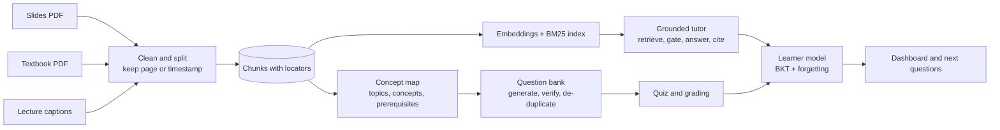

# Cairn: a source-grounded study companion

Multimodal AI Hackathon 2026 (IIT Mandi), Track D: Personalized Tutoring and Adaptive Learning.

**Live app:** _add the link here_  |  **Demo video:** _add the YouTube link here_

Cairn turns lecture videos, slides and textbooks into one cited knowledge base. It answers questions only from that
material (and says so when the material does not cover a question), generates quizzes whose answer keys are checked
by a second model, and keeps a per-concept estimate of what each student knows so practice goes where it is needed.

The demo course is **Database Management Systems**: 16 NPTEL lectures (IIT Kharagpur), 5 chapters of the
Silberschatz, Korth and Sudarshan slides, and the open textbook *Database Design* (Watt and Eng, CC BY 4.0).

## What it does

| Page | What it offers |
|---|---|
| Tutor | Answers with numbered citations that open the exact slide, page or video moment. Questions the course does not cover are declined, with any general-knowledge remark kept apart and labelled. |
| Quiz | Diagnostic quiz for new students, adaptive practice, or a mock exam on topics you choose. Previous, skip and finish screens. Cited feedback on every answer, a report of weak concepts and likely misconceptions, and a history where every past quiz can be reviewed. |
| Dashboard | Mastery by topic and concept, weak spots with cited reading, concepts fading from memory, progress over time, and a prerequisite map coloured by mastery. |
| Upload | Add a PDF (slides or textbook) or a YouTube lecture. It goes through the same pipeline and the tutor cites it too. |
| Evaluation | The benchmarks below, measured on this course. |

## Architecture



`core/` holds the logic (no Streamlit in it, so it is testable), `pages/` the interface, `scripts/` the offline
build and evaluation steps, `data/kb/` the built knowledge base, `data/eval/` the benchmark results.

## Knowledge base

* **Ingestion without manual preparation.** PDFs are read block by block. Headers, footers, copyright lines and slide
  numbers are found by what repeats across the pages of the same document (not by rules for one publisher), and
  template graphics are separated from real figures the same way. Video uses captions with their timestamps, merged into
  passages of about 45 seconds that end on a sentence. Result: **1,024 passages** (296 slides, 252 textbook, 476 video),
  each stored with its source and its page, slide or start time.
* **Concept map.** A model proposes 6 to 8 concepts per topic from the slide titles, with prerequisites; the graph is
  checked (every prerequisite exists, no cycles) and every passage is tagged by embedding similarity, restricted to its
  own topic. Result: **5 topics, 40 concepts**, every passage tagged.
* **Figures.** Pages with real images or diagrams are detected (145 pages) and recorded. Their content is **not yet
  described by a vision model** (see Limitations).

## Source grounding

1. **Retrieve:** dense search (BAAI/bge-small-en-v1.5) and BM25, fused by reciprocal rank, top 6 passages.
2. **Gate:** if even the best passage is below a similarity of 0.58, the question is declined without offering sources.
   The threshold comes from data: on 10 course questions the best score was 0.69 to 0.88, on 8 off-topic questions 0.44 to 0.65.
3. **Answer or decline:** the model must reply in a fixed JSON format, answer only from the numbered passages, and set
   `covered` to false when they do not contain the answer. Only the sources it used are cited.
4. **Cite:** citations are links to the page (`#page=N`), or the video at the cited second.
5. **Outside knowledge** is returned in a separate field and shown under its own label, never mixed into the answer.

## Assessment

* A question is written by one model from **one passage** (so it always has a source), with a different angle per
  slot (define, why, apply, tell apart) and a difficulty from 1 to 5. Phrases that point at the source ("according to the
  passage") are removed, and questions that are really about the source are refused.
* A **different model** then checks it: for multiple choice it answers blind and must pick the same option and find the
  options unambiguous; for short answers it must confirm the key against the passage.
* Near-duplicates are removed by embedding similarity, and a student is never shown a question they have already answered.
* Short answers are graded by the second model against the model answer and the passage. Feedback cites the source.

## Learner model

Bayesian Knowledge Tracing per concept: the probability that the student knows it, updated after every answer.
Hard questions are harder to guess (guess = 0.25 for multiple choice and 0.08 for short answers, scaled by difficulty)
and slightly easier to slip on. Mastery decays between sittings along a forgetting curve whose half-life starts at
1.5 days and grows with each correct answer. A new student's prior depends on how well the prerequisites are known, and a
short diagnostic quiz covers every topic. Questions asked in the tutor count as weak evidence of not knowing a concept yet.

Next questions favour weak concepts, difficulty that fits the current mastery (1 + 4 x mastery), concepts due for review,
and concepts whose prerequisites are known, at most two per concept per quiz.

## Evaluation (all numbers are measured; see the Evaluation page)

**Question bank.** 116 questions generated, **98 verified (84%)**. Rejected: 13 too similar to an accepted question,
4 where the second model disagreed with the answer key, 1 that referred to its source.

**Tutor benchmark.** 30 questions written by a model from randomly chosen passages (10 per source type) and 12 questions
the course does not cover; answers by gpt-oss-120b, judged by a different model family (Qwen). Metrics follow the
standard definitions (the RAGAS library was not used; its metrics were implemented directly).

| Metric | Result |
|---|---|
| Faithfulness | 93% |
| Answer relevancy | 97% |
| Context precision / context recall | 81% / 95% |
| Source passage in the top 1 / 3 / 6 | 57% / 93% / 97% (MRR 0.74) |
| Source cited in the answer | 93%; 89% of cited sources were relevant |
| Off-material questions declined | 12 of 12 (9 by the similarity gate, 3 by the model's own check) |
| Course questions wrongly declined | 0 of 30 |

**Personalization (simulated students).** 200 simulated students (four profiles) took 6 sittings of 10 questions, 3 days
apart, under three policies. They answer with guess and slip rates that differ from the model's, learn from practice, and forget.

| Forgetting per gap | Adaptive minus random (mastery gain, mean ± s.e.) | Adaptive minus a quiz with no memory |
|---|---|---|
| 8% (slow) | +0.008 ± 0.007 (not significant) | +0.019 ± 0.006 |
| 25% (realistic) | +0.015 ± 0.006 | +0.023 ± 0.006 |
| 40% (fast) | +0.024 ± 0.006 | +0.018 ± 0.006 |

Repeated questions: **0%** for adaptive and for random-with-history against 22% for a quiz with no history. The learner
model's error against the hidden truth falls from 0.340 to 0.164 (Brier score) over the six sittings.

**How to read these.** The effect of adaptive selection over random selection is small but consistent. The mastery
estimates it produces are about as accurate as those from random questions, not more accurate. The simulator is a sanity
check, not a study of real learners: the size of the gains depends on the simulator's learning and forgetting assumptions,
and absolute gains can be negative when simulated students forget faster than a few quizzes teach.

## Limitations

* **Figures:** detected, but not yet described by a vision model, so diagrams contribute only through the text around them.
* **Not built:** Hindi or other Indian-language interaction, audio tutoring, numerical question type, flashcards, study schedule.
* **Speech-to-text:** videos need captions. A Whisper fallback for uncaptioned video is not built.
* **Uploads** are searchable and cited by the tutor, but are not tagged to concepts, so quizzes and the dashboard cover the pre-built course. Scanned PDFs are not read.
* **Test sets are small and model-written** (30 + 12 questions), so the benchmark has wide error bars. 12 of 12 refusals and 0 of 30 wrong refusals are encouraging, not conclusive.
* **Learner state** is kept in SQLite on the host; on a free host it can reset when the app restarts.
* The slides' licence allows personal and course use; hosting them publicly here is for demonstration only.

## Run it

```bash
python -m venv .venv && source .venv/bin/activate     # Windows: .venv\Scripts\activate
pip install -r requirements.txt
cp .env.example .env        # add GROQ_API_KEY and set the model names
streamlit run app.py
pytest                      # more than 100 tests
```

Rebuild the course (needs `data/raw/captions`, from `scripts/fetch_captions.py`): `build_chunks.py`, `build_index.py`,
`build_concepts.py`, `build_questions.py`; evaluate with `run_rag_eval.py` and `run_simulation.py`.